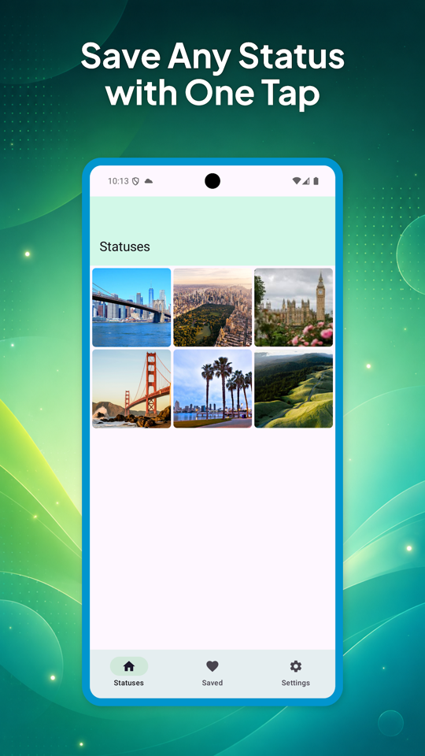
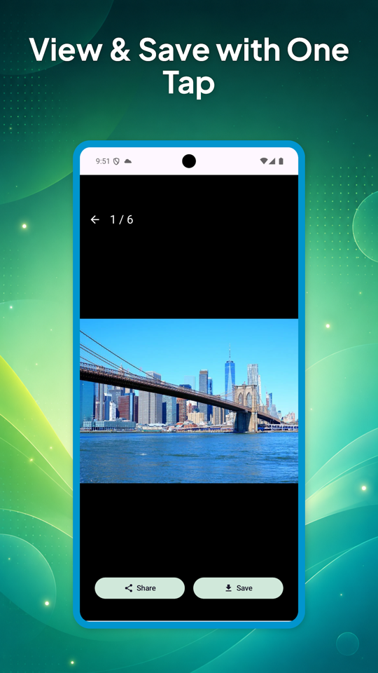
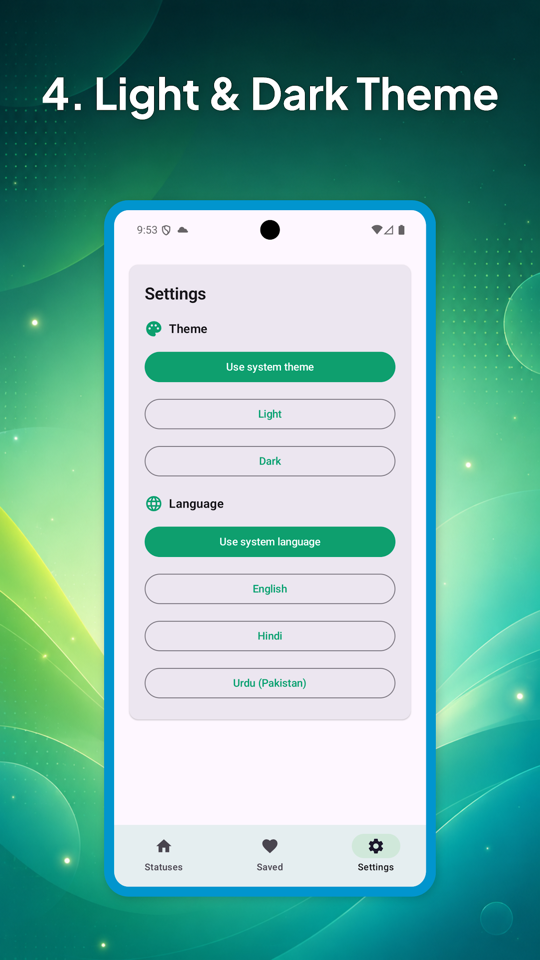
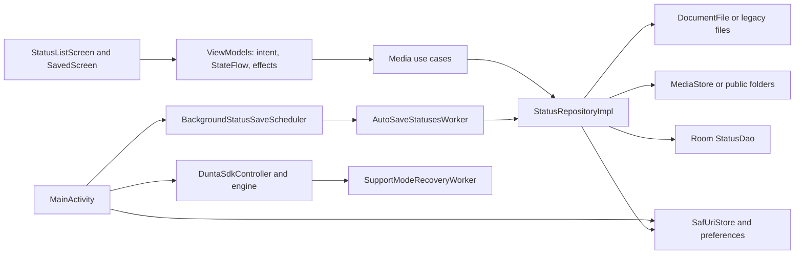

# StatusSave

**Android media utility · Kotlin · Jetpack Compose · Android 8.0+**

Browse locally available status photos and videos, preview them, and save selected media to the gallery. This project brings together Android storage compatibility, coordinated foreground/background saves, reactive persistence and an optional consent-controlled SDK integration.

[Google Play](https://play.google.com/store/apps/details?id=com.statusvideo.statussaver) · [Engineering decisions](#engineering-decisions) · [Code map](#code-map) · [Build and run](#build-and-run)

### Engineering highlights

| Challenge | Implementation to review |
| --- | --- |
| **Storage across Android versions** | Persisted SAF folder grants and legacy file access feed one repository; MediaStore publishes exported copies. [Storage implementation](app/src/main/java/com/statusvideo/statussaver/data/repository/StatusRepositoryImpl.kt) |
| **Overlapping save requests** | A coroutine `Mutex`, Room lookups and in-flight source IDs coordinate manual saves with auto-save; background copies run in batches of up to three. [Save coordination](app/src/main/java/com/statusvideo/statussaver/data/repository/StatusRepositoryImpl.kt#L140) |
| **Background execution and opt-out** | Unique WorkManager jobs apply battery/storage constraints; SDK recovery has separate consent checks, constraints and cancellation. [Media scheduler](app/src/main/java/com/statusvideo/statussaver/data/worker/BackgroundStatusSaveScheduler.kt) · [SDK recovery](app/src/main/java/com/statusvideo/statussaver/core/dunta/SupportModeRecoveryWorker.kt) |

The [engineering tour](#engineering-decisions) explains the constraints, tradeoffs and current boundaries behind these choices. Application ID: `com.statusvideo.statussaver`.

## In the app

| Browse available statuses | Preview, save and share | Appearance and language |
| :---: | :---: | :---: |
|  |  |  |

These are official Google Play listing images containing real application screens, reduced proportionally for documentation. They show the published release; the current checkout also contains auto-save and optional support-mode settings. [Source images and provenance](docs/portfolio/SOURCES.md).

## Capabilities

- **Folder access:** on Android 11+, choose a `.Statuses` folder with guided entry points for WhatsApp or WhatsApp Business. The app retains read access through a persisted document-tree grant.
- **Media browsing:** a three-column photo/video grid, pull-to-refresh, long-press selection and a batch save action. Coil extracts video frames for thumbnails.
- **Preview:** swipe between photos/videos, save the current item, or share through Android's chooser. Media3 plays the active video and releases its player when its page leaves composition.
- **Gallery export:** use MediaStore on Android 10+ and public Pictures/Movies folders on earlier versions. A Room index powers the saved collection and deletion.
- **Auto-save:** an opt-in WorkManager job scans for new statuses, including while the UI is closed, subject to battery/storage and platform scheduling constraints.
- **Preferences:** system/light/dark theme and system/English/Hindi/Pakistani Urdu language selection, persisted with DataStore and applied through AppCompat locales.
- **Optional support mode:** a separately controlled Dunta network-sharing integration with consent, notification handling, a stop control, battery settings and constrained recovery jobs.

Media browsing and copying use local files/content URIs and need no account or server API. Optional support mode performs network activity, so the entire application should not be described as network-free.

## Engineering decisions

### Work across two Android storage models

**Constraint:** newer Android versions restrict direct access to another app's media directory. [MainActivity](app/src/main/java/com/statusvideo/statussaver/MainActivity.kt) opens `ACTION_OPEN_DOCUMENT_TREE`, starts at the selected messaging app's status directory, checks that the chosen document path ends in `.Statuses`, and requests a persistable read grant. [SafUriStore](app/src/main/java/com/statusvideo/statussaver/data/repository/SafUriStore.kt) stores the tree URI in DataStore.

[StatusRepositoryImpl](app/src/main/java/com/statusvideo/statussaver/data/repository/StatusRepositoryImpl.kt) reads `DocumentFile` children on Android 11+ and the legacy `WhatsApp/Media/.Statuses` directory on Android 10 and below. It filters known image/video extensions and sorts by modification time. Legacy files use `FileObserver`; SAF listings are re-read on manual refresh. This respects user-selected access without requiring broad filesystem access. Only one tree URI is retained at a time, and WhatsApp Business has a dedicated picker target only on the SAF path.

### Coordinate foreground and background saves

**Constraint:** an item can be requested by a user action and a background scan at the same time. The singleton repository reserves source IDs under a coroutine `Mutex`, checks existing IDs in Room and tracks in-flight IDs before copying. Auto-save processes batches of at most three concurrent copies with `supervisorScope`, `async` and `awaitAll`; one failed item does not cancel its siblings. Reservation cleanup runs in `finally` after each attempted copy.

This bounds concurrent disk work and suppresses duplicate saves within the application process. Manual multi-selection is processed sequentially and reports success/failure counts through a buffered effect channel. IDs identify source paths/URIs rather than file contents, so duplicate detection is not content-based or a cross-process guarantee. Per-item auto-save failures are counted as unsuccessful copies; only a top-level scan failure causes the worker to request retry.

### Publish copies to the gallery and keep an observable index

**Constraint:** exported files must be visible to other gallery apps while the application still needs its own saved collection. On Android 10+, the repository inserts an image/video MediaStore row with `IS_PENDING`, streams the source into the destination, then publishes the row. A Room entity records the source identity and destination URI. Room `Flow` updates the saved screen after inserts and deletes. Sharing uses a content URI directly or wraps legacy files with `FileProvider` and a temporary read grant.

This separates shared media from application metadata. The file copy and database insert are separate operations, without a rollback transaction spanning both. Output names/MIME types are currently fixed to JPEG/MP4 by media category; bytes are copied without transcoding even when another supported extension was read. Externally removed files are not automatically reconciled with the Room index.

### Keep two background responsibilities independent

**Constraint:** media auto-save and the optional SDK have different prerequisites and opt-out behavior. [BackgroundStatusSaveScheduler](app/src/main/java/com/statusvideo/statussaver/data/worker/BackgroundStatusSaveScheduler.kt) creates unique periodic work at a 15-minute interval and optional immediate work. It requires battery/storage not low; [AutoSaveStatusesWorker](app/src/main/java/com/statusvideo/statussaver/data/worker/AutoSaveStatusesWorker.kt) checks the preference again before accessing the repository through a Hilt entry point.

SDK recovery has its own unique jobs, requires stored consent and battery-optimization exemption, and uses unmetered-network or charging-plus-connected-network constraints. A shared recovery mutex serializes overlapping restart attempts. Explicit disable stops the SDK and cancels recovery. Foreground consent requests notification permission and retains pending decisions across activity recreation; background recovery checks its own prerequisites independently. The interval is a scheduling request rather than a guarantee of 15-minute execution. [DuntaSdkController](app/src/main/java/com/statusvideo/statussaver/core/dunta/DuntaSdkController.kt) exposes SDK state to Compose, while the engine wraps provider calls and debug-only diagnostics observe service/network state.

## Architecture

This is one Android application module. The media feature uses explicit intent/state/effect contracts in ViewModels, repository interfaces and small use-case classes. Hilt binds the storage implementation and provides Room. The activity directly owns folder permissions, preferences, locale changes and SDK integration; these responsibilities are not all routed through the media ViewModels.



A save starts as a `StatusListIntent`, runs through `SaveStatusUseCase`, and returns a `Result` from the repository. The ViewModel clears selection and sends a snackbar effect. The saved tab observes Room separately, so a completed insert becomes visible without manually rebuilding its list. Navigation retains the preview's media list in Compose memory; it is not persisted for process recreation. Refresh currently starts another long-lived listing collector without cancelling the previous one.

### Stack used in the code

| Technology | Role |
| --- | --- |
| Kotlin coroutines, `StateFlow`, channels and `Mutex` | UI state/effects, asynchronous IO and save coordination |
| Compose Material 3, Navigation Compose and Accompanist SwipeRefresh | Media grid, pager, settings, tabs and refresh gestures |
| Hilt with KSP | ViewModel injection, repository/database provisioning and worker entry points |
| Room | Saved-media metadata and reactive collection |
| Preferences DataStore | Folder URI, theme, language and auto-save preference |
| AndroidX DocumentFile, MediaStore and FileProvider | Scoped storage, gallery export and URI sharing |
| Coil and its video decoder | Image loading and video thumbnails |
| Media3 ExoPlayer | Video preview and page-dependent playback |
| WorkManager | Media auto-save and separately constrained SDK recovery |
| AppCompat locales and bundled Dunta AAR | Language application and optional support-mode integration |

## Code map

| Path | Responsibility |
| --- | --- |
| [MainActivity.kt](app/src/main/java/com/statusvideo/statussaver/MainActivity.kt) | Folder grants, permissions, settings and integration lifecycle |
| [ui](app/src/main/java/com/statusvideo/statussaver/ui/) | Media intent/state/effect contracts, Compose screens and navigation |
| [domain](app/src/main/java/com/statusvideo/statussaver/domain/) | Status model, repository contract and media use cases |
| [data/repository](app/src/main/java/com/statusvideo/statussaver/data/repository/) | Storage access, copying, save coordination and preferences |
| [data/local/db](app/src/main/java/com/statusvideo/statussaver/data/local/db/) | Room database, entity and DAO |
| [data/worker](app/src/main/java/com/statusvideo/statussaver/data/worker/) | Media auto-save worker and unique-work scheduler |
| [core/dunta](app/src/main/java/com/statusvideo/statussaver/core/dunta/) | SDK engine, consent state, recovery, battery settings and diagnostics |
| [SDK integration note](docs/dunta-sdk-integration.md) | Existing detailed integration rationale and historical verification record |
| [instrumented tests](app/src/androidTest/java/com/statusvideo/statussaver/core/dunta/) | Consent restoration, permission and service lifecycle scenarios |

## Build and run

Open this directory as an independent Android Studio project. The checked-in configuration uses:

| Setting | Value |
| --- | --- |
| Gradle wrapper / daemon JVM | 9.2.1 / JDK 21, pinned by daemon criteria |
| Kotlin Java toolchain | JDK 11, requested with `jvmToolchain(11)` |
| Android Gradle Plugin / Kotlin | 8.9.1 / 2.0.21 |
| Android SDK | Compile/target 36; minimum 26 |
| Java/Kotlin bytecode | JVM 11 |

Install Android SDK Platform 36 and SDK command-line tools, accept SDK licenses, and set `sdk.dir` in an untracked `local.properties` or configure `ANDROID_HOME`. The configured Foojay resolver can provision requested JVMs; first-time toolchain/dependency resolution needs network access.

Copy the safe [Gradle properties example](gradle.properties.example) to `gradle.properties` before syncing. Its provider identifiers default to zero; keep your configured local file untracked.

```bash
./gradlew :app:assembleDebug
./gradlew :app:installDebug
./gradlew :app:testDebugUnitTest
./gradlew :app:connectedDebugAndroidTest
```

The bundled `app/libs/dunta_sdk-release.aar` is required because source code references its API. `DUNTA_PARTNER_ID` and `DUNTA_APPLICATION_ID` are Gradle properties; keep authorized provider values in your local Gradle configuration or pass them with `-P`. Missing properties default to zero, which leaves SDK execution unconfigured; debug builds can still preview the disabled consent UI. Do not copy another application's provider identifiers. Local media functionality needs no web API key. The release build enables R8, but release signing is not configured in the Gradle file.

To exercise media access, first view a status in the source messaging app, then select its `.Statuses` directory when prompted. A real accessible status folder is required; bundled sample photographs are resources, not evidence that a device folder has been read.

## Verification and boundaries

On **1 November 2026**, `:app:assembleDebug` and `:app:testDebugUnitTest` completed successfully with `-PDUNTA_PARTNER_ID=0 -PDUNTA_APPLICATION_ID=0`. The single JVM test is a generated template check. An initial Maven Central HTTP 403 was resolved by restoring the missing dependency from its official endpoint with a matching published checksum; no source or build-file change was needed. Gradle used incremental caches; instrumented/device tests were not run.

The JVM test is the generated arithmetic smoke test. Four SDK instrumentation tests cover consent surviving recreation, persistent decline, notification denial preserving the prior choice, service start/stop and suppression of further reminders after explicit disable. They skip when the SDK is unconfigured. No focused automated tests for SAF traversal, MediaStore copies, concurrent saves or media auto-save were found, and no CI workflow is included in this project.

The Google Play listing was checked against `applicationId` on 1 November 2026. Its older Android-version claims differ from the current Gradle minimum; this README documents the current code. Documentation links and image files were checked locally. The current build result above is separate from the historical integration note; no new device-test result is claimed. Real-device storage grants, provider availability, video lifecycle, background timing and long-running SDK behavior require integration validation.

[Portfolio index](https://github.com/ILYAPROKOFEV101/Android-Portfolio)
